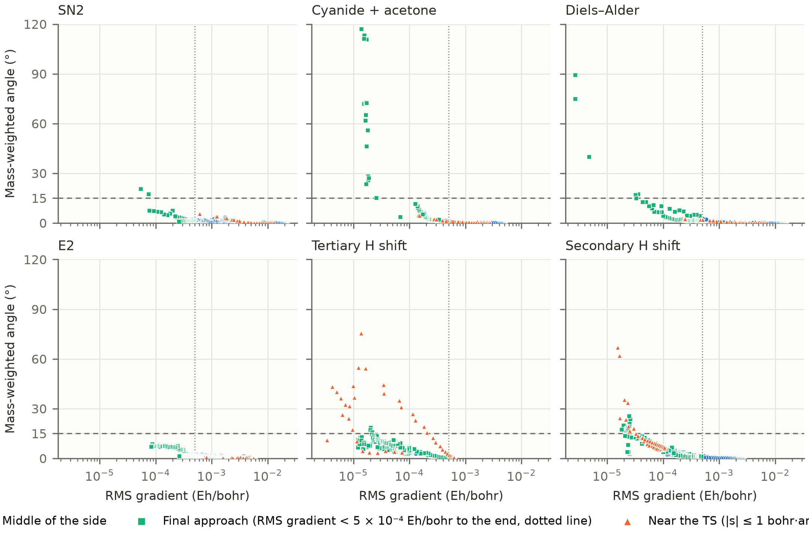

# Angle check against gradient size, all six production paths

Each point is one computed frame of a production IRC side (M06-2X-D3(0)/ma-def2-SVP, SMD; 2212 frames). Vertical axis:
mass-weighted angle between the path direction (central chord) and the downhill gradient, as in the angle check.
Horizontal axis: RMS Cartesian gradient at the frame (Eh/bohr, log scale). Triangles: near the TS (|s| ≤ 1 bohr·amu½);
squares: final approach to a minimum (RMS gradient below 5 × 10⁻⁴ Eh/bohr, dotted line, to the end of the side);
circles: the rest of the side. Dashed line: 15°, the angle check's 90th-percentile limit.

All 70 frames above 15° have an RMS gradient ≤ 2.0 × 10⁻⁴ Eh/bohr (30 near the very flat hydride-shift TSs, 40 in the
final approach to a minimum, none mid-side). Above 5 × 10⁻⁴ Eh/bohr the largest angle is 5.65°. Data:
`angle_vs_gradient.json`; script: `pipeline/angle_vs_gradient.py` (existing path data only). Details: `docs/si_corrections.md`, entry 6.
